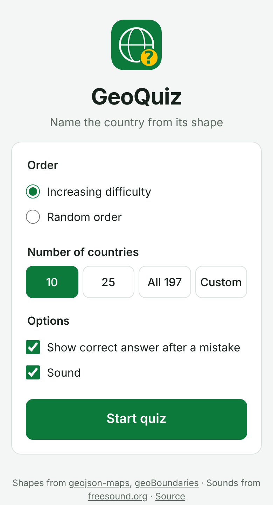
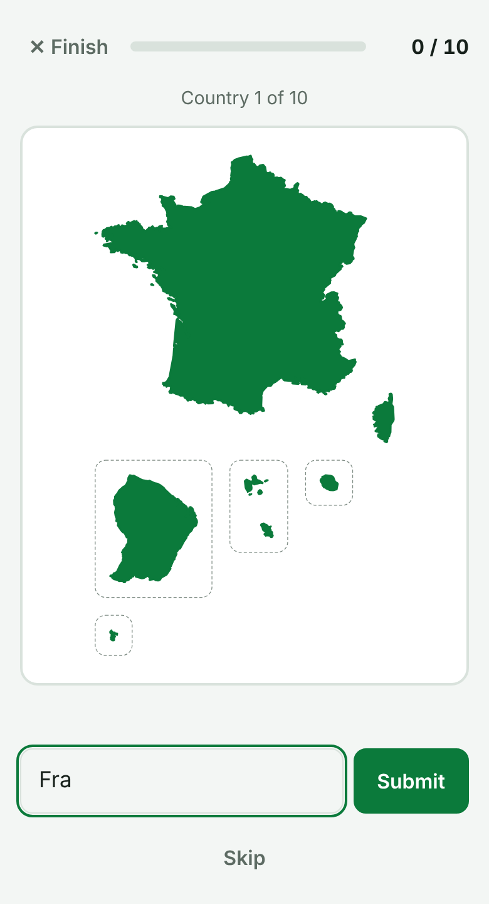

# GeoQuiz: Name the Country From Its Shape

**▶ Play it here: [amrutha-b-nair.github.io/geoquiz](https://amrutha-b-nair.github.io/geoquiz/)**

GeoQuiz is a geography game. You see the outline of a country and type its name. It covers 197 countries, from Russia to Vatican City. It runs in any browser on a phone, tablet or computer; there's nothing to download or sign up for.

  
  &nbsp;&nbsp;
  

## How to play

1. Open **[amrutha-b-nair.github.io/geoquiz](https://amrutha-b-nair.github.io/geoquiz/)**.
2. Choose your settings:
   - **Order:** increasing difficulty (big, well-known countries first) or random.
   - **Number of countries:** 10, 25, all 197, or a number of your choice.
   - **Show the correct answer** after a mistake, and turn **sound** on or off.
3. Type the country's name and press Enter. You can also skip, or finish early.
4. At the end you'll see your score and the countries you missed, so you can review them.

## Good to know

- **Spelling doesn't need to be perfect.** Small typos are forgiven, and common short names work too, like *UK*, *USA*, *UAE*, *DRC* or *Ivory Coast*.
- **Faraway parts are shown in boxes.** For countries like France, the US or Portugal, overseas regions and distant islands are drawn in dashed boxes beside the mainland. They're at the same scale, so their sizes are accurate, but the ocean in between isn't shown.
- **It works offline.** After your first visit you can play without an internet connection.
- **You can install it like an app.** On a phone, open the site and choose *Add to Home Screen* (*Install app* on Android). It then opens full screen from its own icon.
- **Dark mode** follows your device's setting.

## Credits

- Country shapes come from map data by [geojson-maps.ash.ms](https://geojson-maps.ash.ms/) (Natural Earth), [geoBoundaries](https://www.geoboundaries.org/index.html) and [Princeton/Stanford maps](https://maps.princeton.edu/catalog/stanford-sn252ts8433).
- Sounds: [Mudkip2016](https://freesound.org/people/Mudkip2016/sounds/423930/) and [Gronkjaer](https://freesound.org/people/Gronkjaer/sounds/554053/) on freesound.org.

GeoQuiz began as a Python desktop app, which is still in the [`python/`](python/) folder.

Released under the [MIT License](LICENSE).
